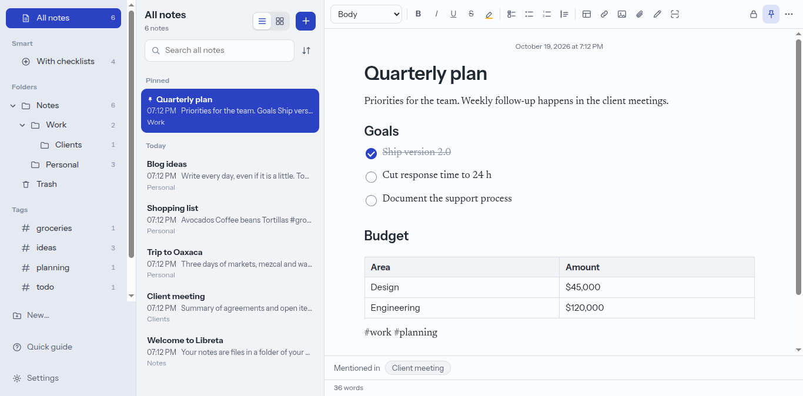
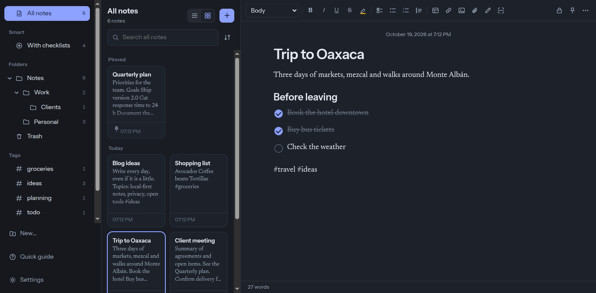
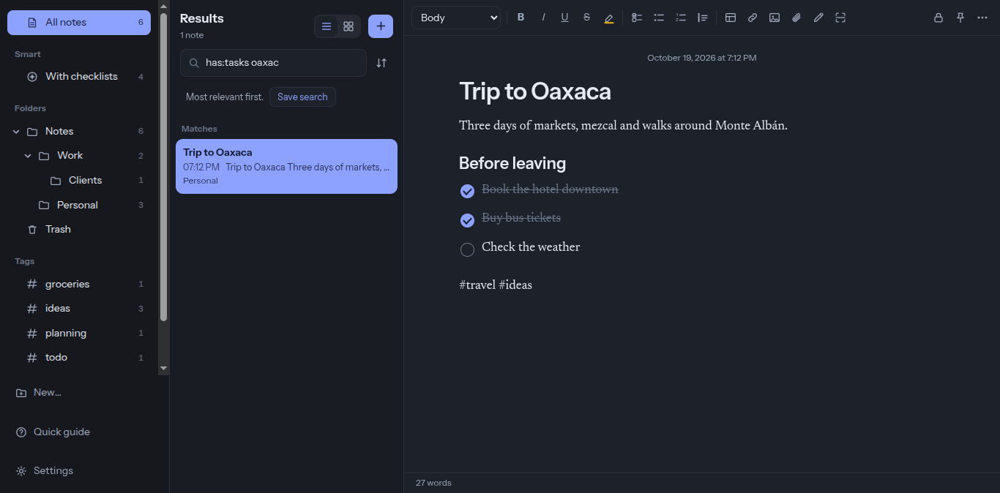

<div align="center">


# Libreta

**Fast, organized notes — open and stored on your own computer.**
For Windows and Linux. No accounts, no cloud, no tracking.

[Español](README.md)

</div>



<details open>
<summary><b>See it in action</b>: new note, <code>[[</code> link, filtered search and theme switch</summary>


</details>

<table>
  <tr>
    <td></td>
    <td></td>
  </tr>
</table>

Libreta brings the workflow of Apple Notes to Windows and Linux — folders, list and gallery views, checklists, tables, attachments, drawing and document scanning — with its own design and your notes kept as **plain files you control**.

> The interface is available in **English and Spanish**. Libreta follows your system language and you can change it in **Settings → Language**. Adding another language is just a JSON file: see [CONTRIBUTING.md](CONTRIBUTING.md).

## Install

Get the installer for your system from [**Releases**](https://github.com/CorreaRicardo98/libreta/releases/latest): a Windows installer or portable `.exe`, a Debian/Ubuntu `.deb`, or a universal Linux `.AppImage`. Windows installers are not code-signed yet, so SmartScreen may warn you: choose *More info → Run anyway*.

## Features

Nested folders and **smart folders**, pinned notes, `#tags`, list/gallery views · checklists, tables, links, images, **any file attachment**, **hand drawing** and **camera document scanning** · **fuzzy, accent-insensitive search** with filters (`tag:`, `folder:`-style `carpeta:`, `tiene:`, `es:`, `antes:`, `despues:`) · **`[[` links between notes** with backlinks · **version history** · **password-locked notes** (AES-256-GCM) · **import** from Markdown/HTML/text folders (Joplin, Obsidian, Bear, Notion) and Evernote `.enex` · export to PDF, HTML or Markdown · light/dark themes.

Each note is a JSON file in a folder you choose, so you can sync it with Syncthing, Nextcloud, Dropbox, etc.

## Contributing

```bash
git clone https://github.com/CorreaRicardo98/libreta.git
cd libreta && npm install
npm run dev   # live-reload app
npm test
```

Read [CONTRIBUTING.md](CONTRIBUTING.md) (in Spanish) for the code layout, and the [roadmap](ROADMAP.md) for ideas. Issues and pull requests in English are welcome too.

## License

[MIT](LICENSE)
