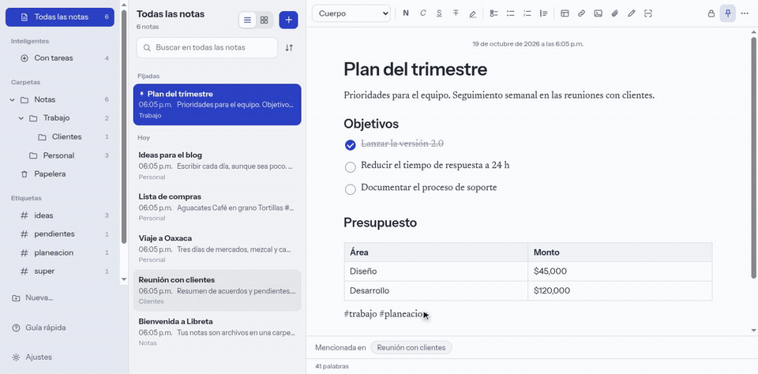
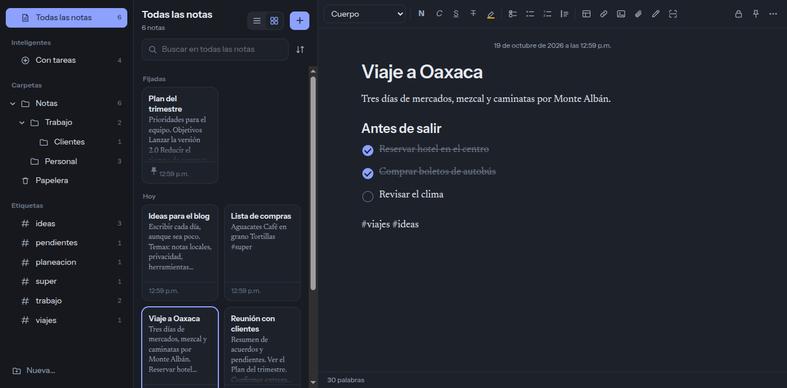
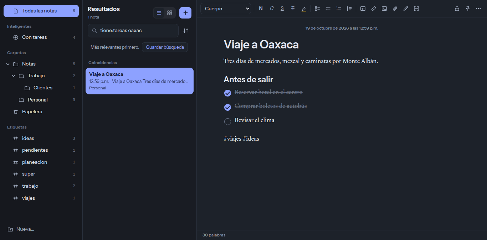

<div align="center">


# Libreta

**Notas rápidas y organizadas, abiertas y en tu computadora.**
Para Windows y Linux. Sin cuentas, sin nube, sin rastreo.

[](https://github.com/CorreaRicardo98/libreta/actions/workflows/ci.yml)
[](LICENSE)
[](https://github.com/CorreaRicardo98/libreta/releases/latest)

[English](README.en.md)

</div>


<details open>
<summary><b>Míralo en acción</b>: nota nueva, enlace con <code>[[</code>, búsqueda con filtro y cambio de tema</summary>



</details>

Libreta lleva a Windows y Linux la forma de trabajar de las notas de Apple —carpetas, lista, galería, listas de tareas, tablas, adjuntos, dibujo y escaneo—, con diseño propio y con tus notas guardadas como **archivos que tú controlas**.

## Instalar

Descarga el instalador de tu sistema desde [**Releases**](https://github.com/CorreaRicardo98/libreta/releases/latest):

| Sistema | Archivo |
| --- | --- |
| Windows | `Libreta Setup X.Y.Z.exe` (instalador) o `Libreta X.Y.Z.exe` (portable, sin instalar) |
| Ubuntu / Debian | `libreta_X.Y.Z_amd64.deb` |
| Cualquier Linux | `Libreta-X.Y.Z.AppImage` |

```bash
# Debian / Ubuntu
sudo apt install ./libreta_X.Y.Z_amd64.deb

# AppImage
chmod +x Libreta-X.Y.Z.AppImage && ./Libreta-X.Y.Z.AppImage
```

> **Aviso en Windows.** El instalador todavía no está firmado digitalmente, así que SmartScreen puede mostrar «Windows protegió su PC». Pulsa **Más información → Ejecutar de todas formas**. Puedes revisar el código y compilarlo tú mismo.

## Actualizaciones

Libreta **te avisa cuando hay una versión nueva** y la instala si tú lo aceptas; nada se descarga ni se instala solo. Funciona con el instalador de Windows y con la AppImage. Con el `.deb` Libreta lo intenta y, si no puede, te lleva a la página de descargas. La versión portable solo te avisa.

Para esto Libreta consulta, cada pocas horas, la lista de versiones de GitHub. No envía tus notas ni datos tuyos (GitHub solo ve que alguien consultó la lista). Puedes apagarlo en **Ayuda → Buscar actualizaciones automáticamente**, o buscar a mano con **Ayuda → Buscar actualizaciones…**. Las notas viven en otra carpeta y nunca se tocan al actualizar.

## Qué puedes hacer

- **Organizar**: carpetas y subcarpetas, notas fijadas, etiquetas con `#palabra`, vista de lista o galería, arrastrar notas entre carpetas y papelera con 30 días de recuperación.
- **Carpetas inteligentes** que reúnen solas las notas por reglas: con tareas, con imágenes, con adjuntos, con tablas, fijadas, por etiqueta, por texto o por búsqueda guardada.
- **Escribir**: títulos, negritas, cursivas, subrayado, resaltado, listas, **listas de tareas**, citas, **tablas** y enlaces.
- **Adjuntar**: imágenes, **archivos de cualquier tipo**, **dibujo a mano** y **escaneo de documentos** con la cámara.
- **Encontrar**: búsqueda que ignora acentos, tolera errores de escritura y ordena por relevancia. Con filtros como `tag:ideas`, `carpeta:trabajo`, `tiene:imagen`, `es:fijada`, `antes:2026-01-31`, `"frase exacta"` y `-excluir`.
- **Conectar ideas**: escribe `[[` para enlazar otra nota; cada nota muestra qué otras la mencionan.
- **No perder nada**: **historial de versiones** de cada nota, con restauración.
- **Proteger**: **notas bloqueadas con contraseña** (AES-256-GCM) y **copias de seguridad automáticas** en un `.tar.gz` con fecha (Ajustes → Copias de seguridad).
- **Traer lo que ya tienes**: importa desde carpetas de Markdown, texto o HTML (Joplin, Obsidian, Bear, Notion; Apple Notes exportada con una herramienta de terceros) y desde Evernote (`.enex`).
- **Compartir y exportar**: copiar como texto o Markdown, enviar por correo, exportar a PDF, HTML o Markdown.
- **Ajustes** (`Ctrl+,`): tema automático, claro u oscuro, seis colores de acento, letra y tamaño del texto de las notas, ancho de la página, vista y orden de la lista, carpeta de notas y actualizaciones.
- **Guía dentro de la app**: **Ayuda → Guía rápida** (`F1`) o el botón «Guía rápida» de la barra lateral explican dónde está cada función, los filtros de búsqueda y los atajos.
- **Guía de usuario con capturas**: [docs/GUIA.md](docs/GUIA.md) recorre cada función paso a paso.
- **Español e inglés**: Libreta usa el idioma de tu sistema y puedes cambiarlo en Ajustes → Idioma.
- Uso completo con teclado y en ventanas angostas.

<table>
  <tr>
    <td></td>
    <td></td>
  </tr>
</table>

## Tus notas son tuyas

Cada nota es un archivo JSON en una carpeta (por defecto `~/Documentos/Libreta`). Puedes cambiarla desde **Archivo → Cambiar carpeta de notas** y sincronizarla con Syncthing, Nextcloud, Dropbox o lo que prefieras: Libreta detecta los cambios que otro programa haga en esa carpeta.

Para compartir una libreta entre varias personas basta con compartir la carpeta. No hay coedición en tiempo real; si dos personas editan la misma nota a la vez, gana el último guardado.

## Participa

Libreta es software libre y **quiere crecer con la comunidad**. Hay mucho por hacer, desde cosas pequeñas hasta funciones completas:

- Mira la [hoja de ruta](ROADMAP.md) y elige algo.
- Lee la [guía para contribuir](CONTRIBUTING.md): explica cómo está organizado el código y cómo correrlo.
- ¿Una idea o pregunta? Abre una [discusión](https://github.com/CorreaRicardo98/libreta/discussions). ¿Un error? Abre un [issue](https://github.com/CorreaRicardo98/libreta/issues/new/choose).

```bash
git clone https://github.com/CorreaRicardo98/libreta.git
cd libreta
npm install
npm run dev     # app con recarga en vivo
npm test        # pruebas
```

## Construido con

[Electron](https://www.electronjs.org), [Vite](https://vite.dev), [TipTap](https://tiptap.dev) (editor) y [marked](https://marked.js.org) (importación de Markdown). Tipografías: [Instrument Sans](https://fonts.google.com/specimen/Instrument+Sans) y [Newsreader](https://fonts.google.com/specimen/Newsreader).

## Licencia

[MIT](LICENSE) © Ricardo Correa Bautista y colaboradores.
