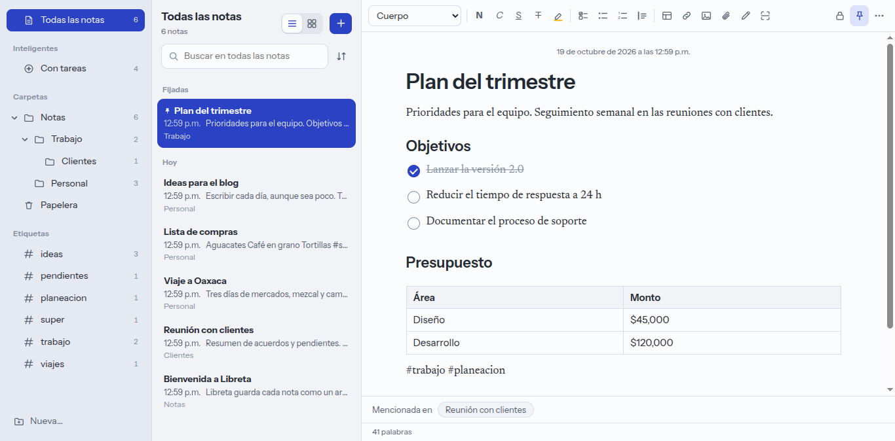
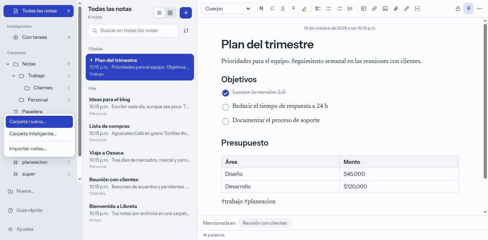
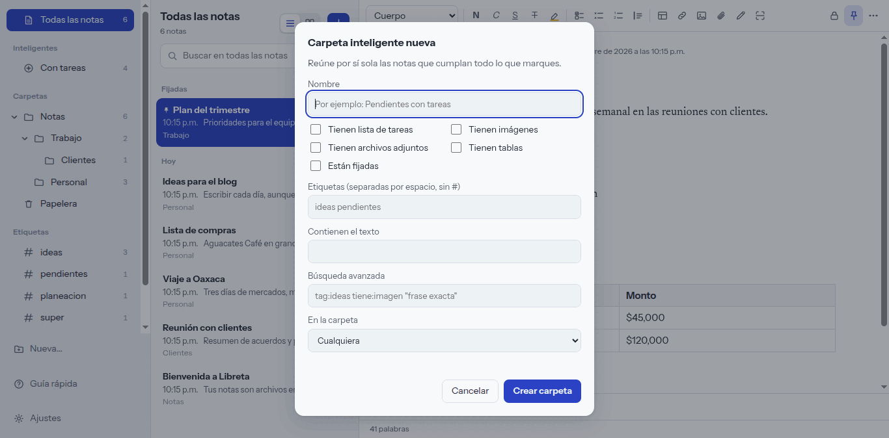
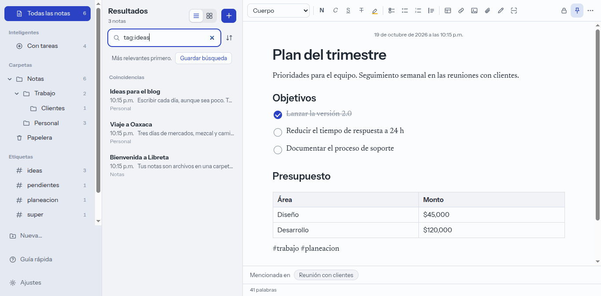
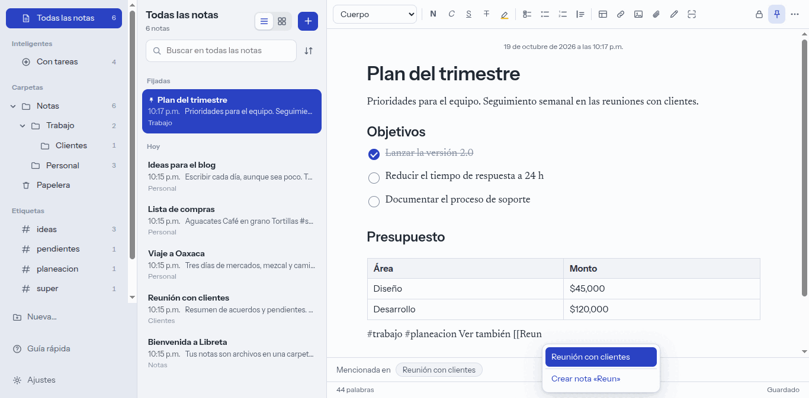
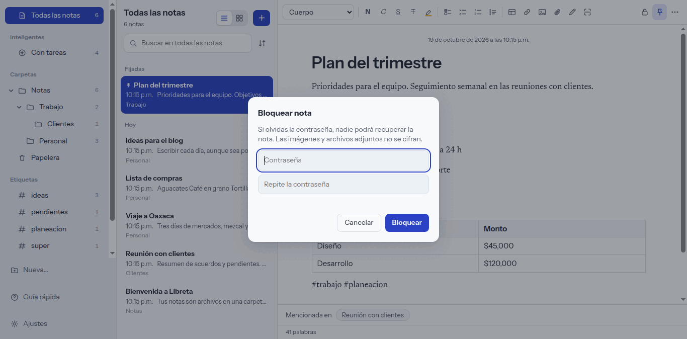
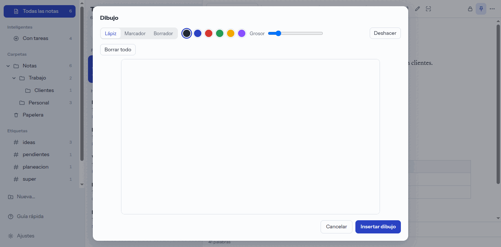
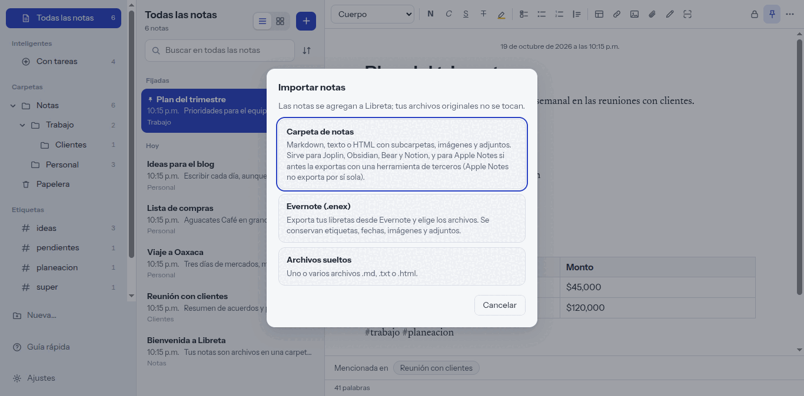
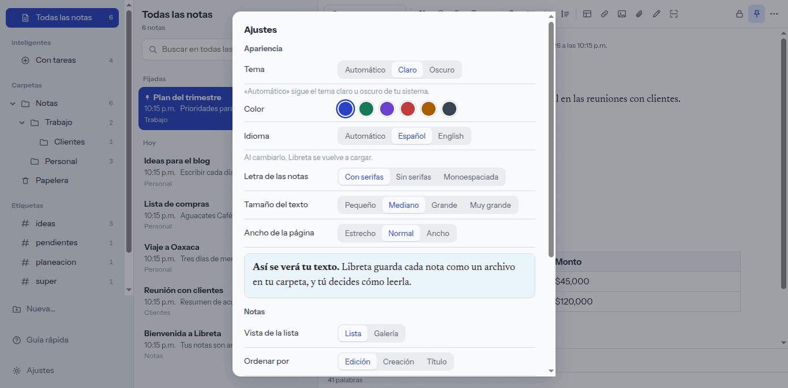

# Guía de usuario de Libreta

Esta guía recorre cada función de Libreta con pasos concretos. Los nombres de botones y menús son los de la interfaz en español. Dentro de la app tienes un resumen en **Ayuda → Guía rápida** (`F1`).

**Contenido**

1. [Notas: crear, editar, fijar y borrar](#1-notas-crear-editar-fijar-y-borrar)
2. [Carpetas](#2-carpetas)
3. [Carpetas inteligentes](#3-carpetas-inteligentes)
4. [Etiquetas](#4-etiquetas)
5. [Búsqueda avanzada](#5-búsqueda-avanzada)
6. [Enlaces entre notas](#6-enlaces-entre-notas-)
7. [Historial de versiones](#7-historial-de-versiones)
8. [Notas bloqueadas con contraseña](#8-notas-bloqueadas-con-contraseña)
9. [Adjuntos, imágenes y tablas](#9-adjuntos-imágenes-y-tablas)
10. [Dibujo](#10-dibujo)
11. [Escáner de documentos](#11-escáner-de-documentos)
12. [Importar](#12-importar)
13. [Exportar y compartir](#13-exportar-y-compartir)
14. [Ajustes e idioma](#14-ajustes-e-idioma)
15. [Tus notas son archivos](#15-tus-notas-son-archivos)
16. [Atajos de teclado](#16-atajos-de-teclado)

---

## 1. Notas: crear, editar, fijar y borrar

- **Crear una nota:** botón **+** arriba de la lista, o `Ctrl + N`. La primera línea es el título.
- **Dar formato:** la barra del editor tiene estilo de párrafo (Cuerpo, Título, Encabezado, Subencabezado, Monoespaciado), negrita, cursiva, subrayado, tachado, resaltado, lista de tareas, lista con viñetas, lista numerada, cita, tabla, enlace, imagen, archivo, dibujo y escáner.
- **Guardado:** automático mientras escribes; abajo aparece «Guardado».
- **Fijar:** el icono de chincheta de la barra (**Fijar nota**) sube la nota a la sección «Fijadas». Pulsa de nuevo para **Quitar de fijadas**.
- **Mover a la papelera:** menú **Más acciones** (`…`, arriba a la derecha) o tecla `Supr` con la nota seleccionada en la lista. Las notas de la **Papelera** se borran solas a los 30 días; ahí puedes **Recuperar nota**, **Eliminar definitivamente…** o **Vaciar papelera**.
- **Ver como lista o galería:** botones de **Vista** arriba de la lista (`Ctrl + 1` / `Ctrl + 2`).
- **Ordenar:** botón **Ordenar** junto al buscador: Fecha de edición, Fecha de creación o Título.

## 2. Carpetas

1. Abajo a la izquierda pulsa **Nueva…** y elige **Carpeta nueva…** (`Ctrl + Mayús + N`).
2. Escribe el nombre y pulsa **Crear carpeta**.
3. **Subcarpetas:** clic derecho sobre una carpeta → **Subcarpeta nueva…**.
4. **Mover una nota:** arrástrala de la lista hasta la carpeta, o usa el menú `…` → **Mover a**.
5. Clic derecho sobre una carpeta también permite **Nota nueva aquí**, **Renombrar carpeta…**, **Mover carpeta a…** y **Eliminar carpeta…** (sus notas van a la papelera).

## 3. Carpetas inteligentes

Reúnen solas las notas que cumplan tus reglas y aparecen en **Inteligentes**.

1. **Nueva…** → **Carpeta inteligente…**.
2. Ponle nombre y marca las reglas: *Tienen lista de tareas*, *Tienen imágenes*, *Tienen archivos adjuntos*, *Tienen tablas*, *Están fijadas*; o escribe etiquetas, un texto, una búsqueda avanzada o limita a una carpeta.
3. Pulsa **Crear carpeta**. Para cambiarla, clic derecho → **Editar reglas…**; borrarla (**Eliminar carpeta inteligente**) no borra notas.

También puedes crear una desde una búsqueda con **Guardar búsqueda** (siguiente sección).

## 4. Etiquetas

Escribe `#etiqueta` en cualquier parte del texto de una nota. Las etiquetas aparecen en la barra lateral, en **Etiquetas**, con el número de notas; haz clic en una para ver solo esas notas.

## 5. Búsqueda avanzada

Escribe en **Buscar en todas las notas** (`Ctrl + F`). Ignora acentos y mayúsculas, perdona errores de escritura y ordena por relevancia. Puedes combinar varios filtros:

| Escribe | Encuentra |
| --- | --- |
| `tag:ideas` | notas con la etiqueta #ideas |
| `carpeta:trabajo` | notas en una carpeta llamada «trabajo» |
| `tiene:imagen` | notas con imágenes (también `tareas`, `adjunto`, `tabla`, `enlace`) |
| `es:fijada` | notas fijadas (también `es:bloqueada`) |
| `antes:2026-01-31` | editadas antes de esa fecha (`despues:` para lo contrario) |
| `"frase exacta"` | esa frase tal cual |
| `presupuesto -cliente` | con «presupuesto» pero sin «cliente» |

En inglés funcionan `tag:`, `folder:`, `has:`, `is:`, `before:` y `after:`. Con **Guardar búsqueda** la conviertes en una carpeta inteligente.

## 6. Enlaces entre notas (`[[ ]]`)

1. Dentro de una nota escribe `[[`.
2. Elige otra nota de la lista, o **Crear nota «…»** si aún no existe.
3. El enlace aparece como una etiqueta en el texto; púlsala para saltar a esa nota.
4. Al pie de cada nota aparece **Mencionada en** con las notas que la enlazan.

## 7. Historial de versiones

1. Abre el menú `…` del editor → **Historial de versiones…**.
2. Libreta guarda una versión cada 5 minutos de edición. Elige una fecha de la lista **Versiones** y verás cómo era la nota.
3. Pulsa **Restaurar esta versión**; la que había antes también se conserva. **Cerrar** sale sin cambios. Si aún no hay versiones, el diálogo lo indica.

Al bloquear, quitar el bloqueo o cambiar la contraseña de una nota, su historial se borra.

## 8. Notas bloqueadas con contraseña

- **Bloquear:** icono de candado de la barra → **Bloquear con contraseña…**, escribe la contraseña dos veces y pulsa **Bloquear**. La nota se cifra en el disco (AES-256).
- **Abrirla:** al seleccionarla pide la contraseña.
- **Opciones de bloqueo** (candado en una nota bloqueada): **Bloquear ahora**, **Cambiar contraseña…** (pide la actual y la nueva; vuelve a cifrar y borra el historial) y **Quitar bloqueo…**.
- Si olvidas la contraseña **nadie puede recuperar la nota**. Las imágenes y los archivos adjuntos no se cifran.

## 9. Adjuntos, imágenes y tablas

- **Imagen:** botón **Insertar imagen**, o pega o arrastra la imagen directamente a la nota.
- **Archivo:** botón **Adjuntar archivo** (clip) o arrastra el archivo. Aparece como una tarjeta con su tipo; púlsala para **Abrir**.
- **Tabla:** botón **Insertar tabla**.
- **Lista de tareas:** botón **Lista de tareas** (`Ctrl + Mayús + 9`).
- Las imágenes y adjuntos se guardan en la carpeta `attachments` de tu carpeta de notas.

## 10. Dibujo

1. Botón **Dibujar** (lápiz) de la barra.
2. Elige herramienta (**Lápiz**, **Marcador**, **Borrador**), color y **Grosor**. **Deshacer** quita el último trazo y **Borrar todo** limpia el lienzo.
3. Pulsa **Insertar dibujo** para ponerlo en la nota.

## 11. Escáner de documentos

1. Botón **Escanear documento** de la barra (necesita una cámara conectada).
2. Elige el filtro: **Documento**, **Grises** o **Color**.
3. Pulsa **Capturar página** por cada hoja; cada una se inserta en la nota. Al terminar, **Listo**.

Si la cámara no abre, revisa que esté conectada y que ningún otro programa la use.

## 12. Importar

**Nueva…** → **Importar notas…** (o **Archivo → Importar notas…**). Tres opciones:

- **Carpeta de notas:** Markdown, texto o HTML con subcarpetas, imágenes y adjuntos. Sirve para Joplin, Obsidian, Bear y Notion. Apple Notes hay que exportarla antes con una herramienta de terceros.
- **Evernote (.enex):** conserva etiquetas, fechas, imágenes y adjuntos.
- **Archivos sueltos:** uno o varios archivos `.md`, `.txt` o `.html`.

Libreta copia el contenido: tus archivos originales no se tocan.

## 13. Exportar y compartir

Menú `…` del editor:

- **Copiar como texto** y **Copiar como Markdown**.
- **Enviar por correo…** (abre tu programa de correo).
- **Exportar** como **PDF**, **HTML** o **Markdown** (también en el menú **Archivo**).

## 14. Ajustes e idioma

**Archivo → Ajustes…** (`Ctrl + ,`) o el botón **Ajustes** de la barra lateral. Los cambios se ven al instante:

- **Tema:** Automático, Claro u Oscuro.
- **Color** de acento (azul, verde, violeta, coral, ámbar o grafito).
- **Idioma:** Automático (usa el de tu sistema), Español o English. Al cambiarlo, Libreta recarga la interfaz.
- **Letra de las notas:** con serifas, sin serifas o monoespaciada; **Tamaño del texto** y **Ancho de la página**.
- **Vista de la lista** y **Ordenar por**.

**Ayuda → Buscar actualizaciones…** comprueba si hay una versión nueva; nada se instala sin que lo aceptes.

## 15. Tus notas son archivos

Cada nota es un archivo JSON en tu carpeta de notas (por defecto `Documentos/Libreta`).

- **Abrir la carpeta:** **Archivo → Abrir carpeta de notas**.
- **Cambiarla:** **Archivo → Cambiar carpeta de notas…**. Puedes apuntarla a una carpeta sincronizada con Syncthing, Nextcloud o Dropbox.
- Los cambios hechos desde fuera de la app (por ejemplo, por la sincronización) se detectan solos.

## 16. Atajos de teclado

| Atajo | Acción |
| --- | --- |
| `Ctrl + N` | Nota nueva |
| `Ctrl + Mayús + N` | Carpeta nueva |
| `Ctrl + F` | Buscar notas |
| `Ctrl + 1` / `Ctrl + 2` | Ver como lista / galería |
| `Ctrl + B` / `I` / `U` | Negrita / cursiva / subrayado |
| `Ctrl + K` | Enlace web |
| `Ctrl + Mayús + 9` | Lista de tareas |
| `[[` | Enlazar otra nota |
| `Ctrl + Z` / `Ctrl + Mayús + Z` | Deshacer / rehacer |
| `Supr` | Mover a la papelera (con la nota seleccionada en la lista) |
| `↑` / `↓` | Cambiar de nota en la lista |
| `Ctrl + ,` | Abrir Ajustes |
| `F1` | Abrir la guía rápida |

En macOS usa `Cmd` en lugar de `Ctrl`.

---

¿Algo no coincide con lo que ves o falta? [Abre un issue](https://github.com/CorreaRicardo98/libreta/issues) o mejora esta guía con un *pull request*.
